<!-- Simpan sebagai README.md di repo bernama sama dengan username kamu: github.com/junizarmaulana/junizarmaulana -->


<div align="center">

<a href="https://github.com/junizarmaulana">
  
</a>

<br/>


</div>



---

## 🧑‍💻 Tentang Saya

```js
const saya = {
  nama: "Junizar Maulana",
  fokus: ["Mobile Development", "Web Design", "Game & Kreatif"],
  sedangBelajar: ["Flutter", "Firebase", "Agent AI"],
  motto: "Kode rapi, tampilan hidup ✨",
  funFact: "Kopi dulu, baru commit ☕"
};
```

## 🛠️ Tech Stack

<div align="center">


</div>

## 📊 Statistik GitHub

<div align="center">


<br/>


<br/>


</div>

## 🐍 Snake Contribution

<div align="center">
  
</div>

## 🚀 Proyek Pilihan

<div align="center">

<a href="https://github.com/junizarmaulana/Kos-Canggi">
  
</a>

</div>

## 🏆 Trofi

<div align="center">
  
</div>

## 📫 Mari Terhubung

<div align="center">

[](https://github.com/junizarmaulana)
[](https://instagram.com/)
[](mailto:email@kamu.com)

</div>


